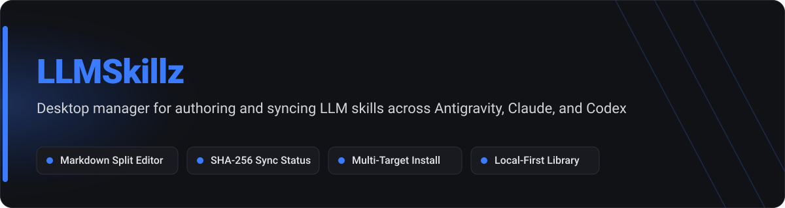
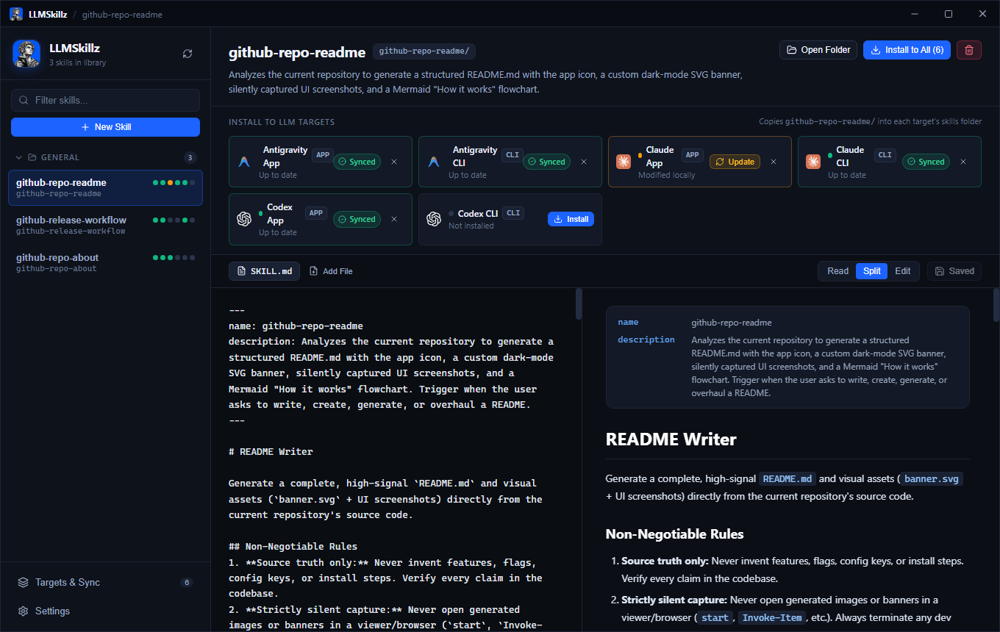
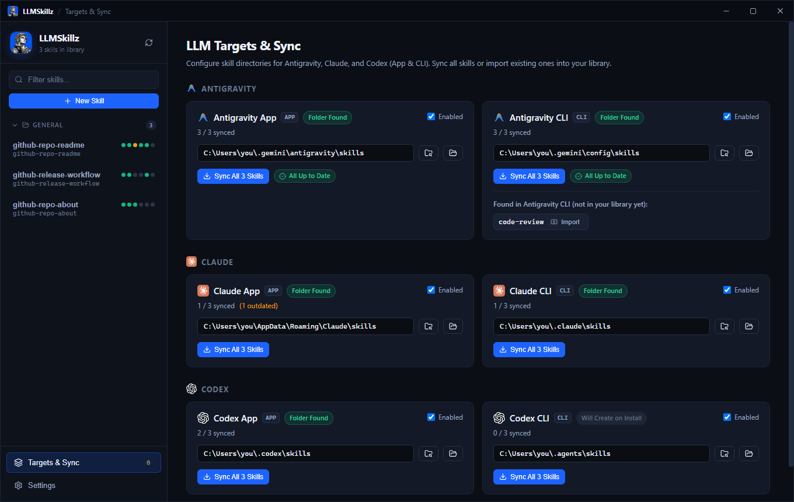
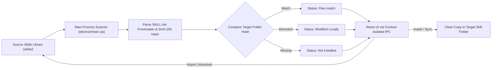

<div align="center">


# LLMSkillz

Desktop manager for authoring, organizing, and syncing custom LLM skills across Antigravity, Claude, and Codex.


<br /><br />



<br /><br />

[Features](#features) • [Screenshots](#screenshots) • [How it works](#how-it-works) • [Installation](#installation) • [Usage](#usage) • [Configuration](#configuration) • [Troubleshooting](#troubleshooting)

</div>

## About

LLMSkillz is a local-first Electron + React + TypeScript desktop application that manages a folder-based library of custom LLM skills (`SKILL.md` plus supporting scripts and references) and synchronizes them to installed LLM client directories. All filesystem operations run in the Electron main process over context-isolated IPC (`contextIsolation: true`, `nodeIntegration: false`) with zero external network calls or cloud accounts required.

## Features

- **Skill Library & Section Grouping** — Scans your source skills directory and loads each folder containing a `SKILL.md` (case-insensitive). Nested category folders automatically appear as collapsible sections in the sidebar with live text filtering across name, folder, section, and description.
- **Markdown Authoring & Live Preview** — Edit `SKILL.md` and supporting files (e.g., `scripts/`, `references/`) in **Read**, **Split**, or **Edit** mode with sanitized GFM rendering (`marked` + `DOMPurify`), parsed YAML frontmatter display, unsaved-change indicators, and `Ctrl+S` saving.
- **Local Copy Status** — Compares local skill files using SHA-256 and checks the installed `SKILL.md` filename. **Files match** reports a matching copy on disk. Each client discovers skills separately.
- **Per-Target & Batch Installation** — Install, update, or uninstall a skill for individual targets (Antigravity App/CLI, Claude App/CLI, Codex App/CLI, or custom targets), push a single skill to all enabled targets at once, or sync your entire library to a target from the **Targets & Sync** view.
- **Untracked Skill Import** — Detects skill folders that exist inside a target directory but not yet in your library, allowing one-click import back into your source library.
- **Custom Targets & Configurable Library Path** — Point LLMSkillz at any local skills folder, add arbitrary custom target paths, toggle targets on or off, open any folder directly in File Explorer, or reset target paths to defaults.

## Screenshots

<p align="center">
  
  <br />
  <em>Skill Workspace in Split mode showing YAML frontmatter preview, Markdown rendering, and per-target SHA-256 sync status.</em>
</p>

<p align="center">
  
  <br />
  <em>Targets &amp; Sync view for configuring Antigravity, Claude, and Codex directories, running bulk syncs, and importing untracked skills.</em>
</p>

## How it works



## Installation

### Pre-built Windows Releases

Download the latest release from the [GitHub Releases](https://github.com/projectGloria/LLMSkillz/releases) page:

- **Installer:** `LLMSkillz-<version>-setup-x64.exe` (NSIS installer with custom install directory option)
- **Portable:** `LLMSkillz-<version>-portable-x64.exe` (standalone executable, no installation required)
- **Checksums:** Verify downloads against `SHA256SUMS.txt` included in each release.

### Run or Build from Source

Requires **Node.js 22+** and **npm**.

```bash
git clone https://github.com/projectGloria/LLMSkillz.git
cd LLMSkillz
npm install
```

| Command | Description |
| --- | --- |
| `npm run dev` | Starts the Vite dev server on `http://localhost:5173` and launches Electron against it. |
| `npm run build` | Type-checks with `tsc --noEmit` and builds the renderer bundle into `dist/`. |
| `npm start` | Runs `npm run build` and launches Electron using the compiled `dist/` output. |
| `npm run pack` | Builds an unpacked Windows directory into `release/` via `electron-builder --dir`. |
| `npm run dist` | Builds Windows NSIS installer and portable `.exe` artifacts into `release/`. |

## Usage

1. **Create a skill:** Click **New Skill** in the sidebar, enter a name (the folder slug is auto-generated), an optional category section subfolder, and a description. LLMSkillz creates the folder with a pre-formatted `SKILL.md` frontmatter template.
2. **Edit & organize files:** Use the toolbar to switch between **Read**, **Split**, and **Edit** views, click **Add File** to create supporting files (such as `scripts/helper.py` or `references/guide.md`), and press `Ctrl+S` (or click **Save**) to write changes to disk.
3. **Install or update targets:** In the **Install to LLM Targets** strip at the top of the workspace, click **Install**, **Update**, or **X** (uninstall) per target, or click **Install to All** to push the skill to every enabled target.
4. **Bulk sync & import:** Open **Targets & Sync** from the bottom-left navigation to edit target paths, toggle targets, click **Sync All Skills** for a target, or click **Import** on any untracked folder found inside a target directory.

## Configuration

Settings are persisted automatically to `llmskillz-config.json` inside Electron's `userData` directory (on Windows: `%APPDATA%\llmskillz\llmskillz-config.json`).

### Library Folder Layout

By default, LLMSkillz uses the `skills/` directory next to the application. You can point it to any folder in **Settings → Source Skills Library**.

```text
skills/
├── github-repo-readme/
│   └── SKILL.md              # Loaded under "General"
└── devops/                   # Category folder -> "devops" section in sidebar
    └── release-check/
        ├── SKILL.md
        └── scripts/
            └── verify.py
```

### Default Target Directories

| Target | Provider | Type | Default Path (Windows) |
| --- | --- | --- | --- |
| Antigravity App | `antigravity` | `app` | `%USERPROFILE%\.gemini\antigravity\skills` |
| Antigravity CLI | `antigravity` | `cli` | `%USERPROFILE%\.gemini\config\skills` |
| Claude App | `claude` | `app` | `%APPDATA%\Claude\skills` |
| Claude CLI | `claude` | `cli` | `%USERPROFILE%\.claude\skills` |
| Codex App | `codex` | `app` | `%USERPROFILE%\.codex\skills` |
| Codex CLI | `codex` | `cli` | `%USERPROFILE%\.agents\skills` |

ChatGPT workspace skills are installed separately through [ChatGPT Skills](https://help.openai.com/en/articles/20001066-skills-in-chatgpt).

You can add additional custom targets or restore the defaults at any time from **Settings**.

## Troubleshooting

- **Target shows "Will Create on Install":** The target's base directory does not exist on disk yet. Clicking **Install** or **Sync All Skills** automatically creates the directory tree before copying the skill folder.
- **Skill stays installed after deleting from the library:** Deleting a skill from your library only removes the source folder inside your library path; installed copies inside LLM target folders are intentionally left untouched. Use the target's uninstall button (`X`) first if you want to remove deployed copies.
- **Hidden files or directories are not synced:** Directories named `.git`, `node_modules`, `.DS_Store`, `__pycache__`, and `.vscode` (as well as dot-prefixed skill folders) are ignored during scanning, hashing, and copying.
- **Changes made outside LLMSkillz do not appear immediately:** Click the refresh icon in the sidebar header to rescan the library and all configured target directories.
